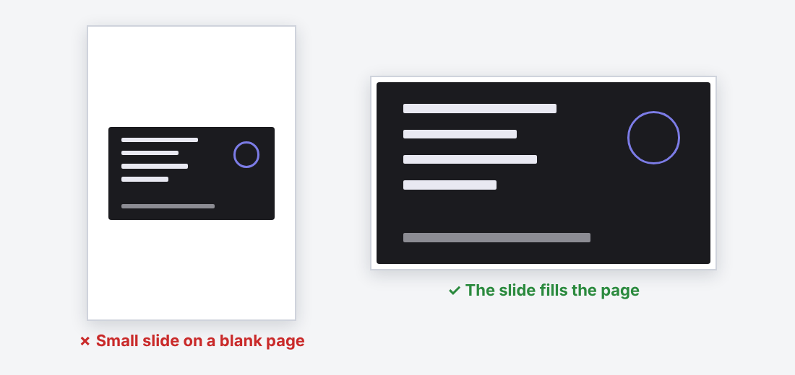

# Excalidraw to PDF

**Convert Excalidraw drawings to PDF with one slide per page and no blank space. Free, open source, and it runs in your browser, so your file is never uploaded.**

**[Open the tool: excalidraw-to-pdf.pages.dev](https://excalidraw-to-pdf.pages.dev/)**



## Why this exists

Many converters use the whole drawing area as the size of each PDF page. If your drawing holds many slides, every page ends up as a small slide floating on a big blank sheet.

This tool cuts every page to just its own content, so a slide fills its page.

## How to use it

1. In Excalidraw, open the menu and choose **Save to…** to get a `.excalidraw` file.
2. Open that file on the website (or drop it on the page).
3. The tool already makes one page for each slide. To change the split, click between two slides to add a cut line. Drag a line to move it, or click its × to remove it.
4. Untick any page you do not want.
5. Press **Download PDF**.

There are no settings to learn.

Shortcuts: **0** fits the drawing to the window, **Ctrl + mouse wheel** zooms, **Delete** removes the selected cut line.

## What it does

- Makes one page per slide automatically, keeping the pen marks and notes around each slide on that slide's page
- Lets you fix the split with simple cut lines, and shows every page exactly as it will appear in the PDF
- Keeps Hindi text correct, using a bundled font
- Runs fully in your browser: no upload, no account, no watermark
- Uses Excalidraw's own renderer, so the drawing looks like it does in Excalidraw

## Known limits

- Each PDF page is a sharp picture, so text in the PDF **cannot be selected or copied**.
- Cut lines are horizontal only. Slides placed side by side in one row share a page.
- If you keep notes far away from a slide, that page gets wide, because nothing is dropped.
- It works best in Google Chrome. It has also been tested in Microsoft Edge.

Found a problem? Please [open an issue](../../issues) with a screenshot of the page list.

## Frequently asked questions

**How do I export Excalidraw to PDF with multiple pages?**
Open your `.excalidraw` file on the website. It makes one page per slide automatically. Click between two slides to add a cut line if you want a different split, then press Download PDF.

**Why are my slides small on a big blank page in other converters?**
That happens when the whole drawing area is used as the page size. Here every page is cut to its own content.

**Is my file uploaded anywhere?**
No. Everything runs in your browser.

## Run it yourself

The finished website is the `site` folder. It is plain static files, so you can put it on any static host (Cloudflare Pages, GitHub Pages, Netlify and so on). To open it from your own computer:

```bash
npm install
npm run web          # builds the site and serves it at http://localhost:8080
```

You can also double-click `site/index.html` to use it straight from disk, without a server.

To publish your own copy with Cloudflare Pages, connect this repository and set the build command to nothing and the output directory to `site`. The step-by-step guide is in [START-HERE.md](START-HERE.md).

## Command-line version (optional)

This repository also holds an older command-line tool that makes **vector** PDFs (selectable text) from Excalidraw frames, using headless Chrome. It is separate from the website and needs Node 18+ and Chrome, Chromium or Edge installed.

```bash
npm install
npm run build                                          # builds dist/bundle.js
node bin/excalidraw2pdf.mjs my-slides.excalidraw       # writes my-slides.pdf
node bin/excalidraw2pdf.mjs --help                     # all options
```

It makes one page per Excalidraw **frame**, cropped to the frame, or the whole drawing on one page if the file has no frames. Dark mode stays vector. Hindi text can differ by a few pixels from what your browser showed, because Excalidraw measures text with the fonts of the browser it ran in.

## Credits

Built on [Excalidraw](https://github.com/excalidraw/excalidraw) (MIT), [React](https://react.dev), [pdf-lib](https://github.com/Hopding/pdf-lib) and open fonts. The full list with licenses is in [THIRD-PARTY-NOTICES.md](THIRD-PARTY-NOTICES.md). This is an independent project and is not affiliated with Excalidraw.

## Contributing

See [CONTRIBUTING.md](CONTRIBUTING.md).

## License

[MIT](LICENSE) © 2026 Moita
